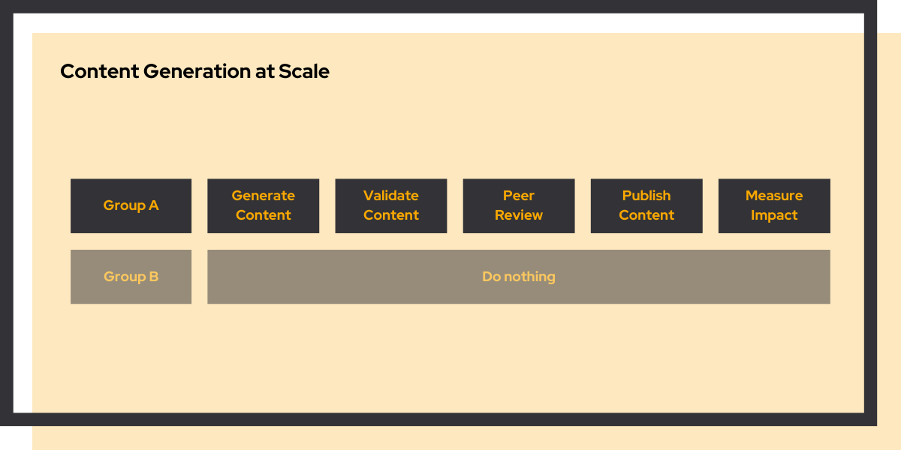
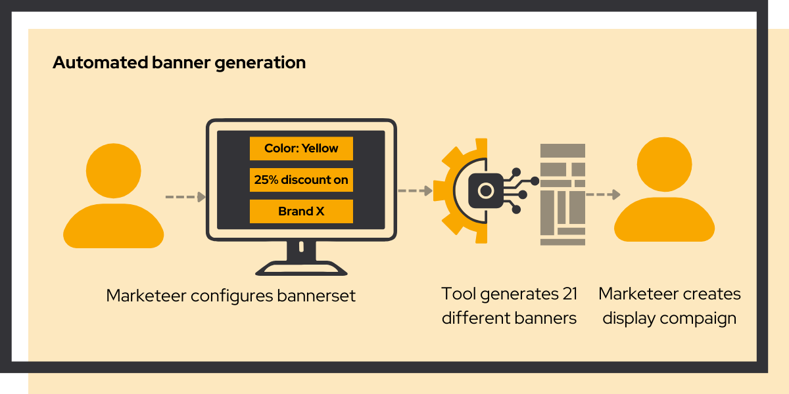
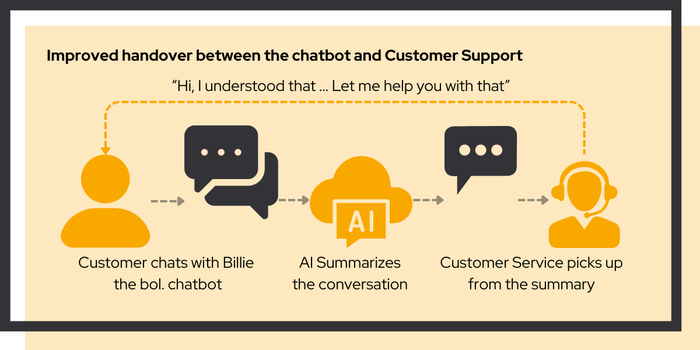
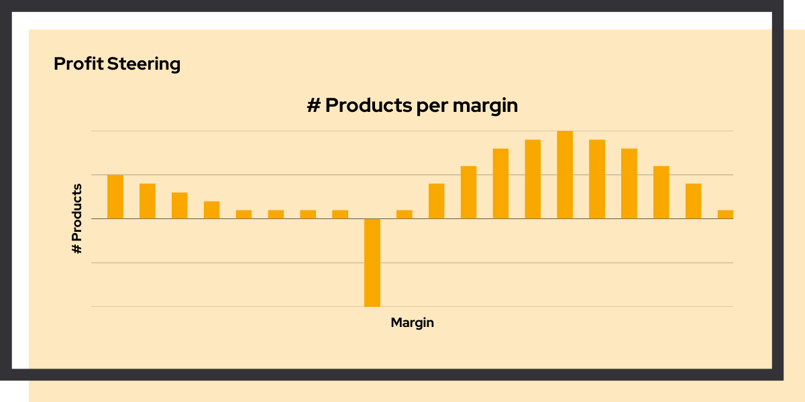
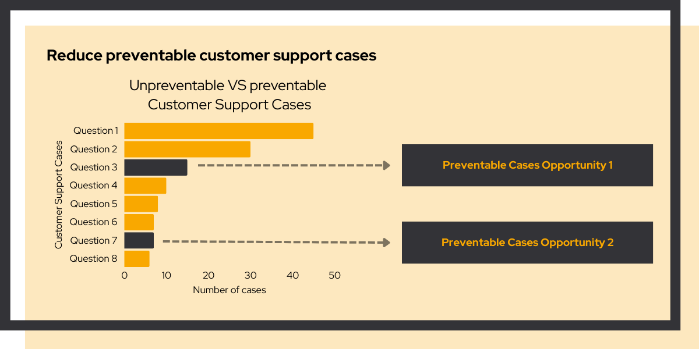

## The ambition

bol.com wanted to grow organic traffic by improving content quality across their entire product catalogue. Millions of pages. Every one of them a potential SEO improvement. The ambition was clear. The scale made it feel impossible.

## The challenge

Optimizing content at this scale introduced three problems that ruled out every obvious solution:

**No standard A/B testing for SEO.** Google indexes each page once. Running a split test meant finding a way to group millions of product pages into statistically comparable sets before touching a single one.

**Manual work that doesn't scale.** Optimizing a product page takes time and expertise. At a million pages, that's over two years of full-time writing work. It needed to be automated without sacrificing quality.

**Quality assurance at scale.** When you generate content for millions of pages, you can't review them all. We needed a system that guaranteed accuracy while surfacing the small percentage that needed human eyes.

## Where we started

> Think big, start small.

We didn't begin with a million pages. We began with one experiment on one product category with one clear hypothesis: can AI-generated content outperform the existing copy on organic traffic?

To answer that, we built four things:

- **Group sampling**: A statistical method to create comparable test and control groups from millions of pages, so results would be meaningful

- **Content generation**: An LLM-powered pipeline that wrote optimized content following bol.com's brand guidelines

- **Content validation**: Automated quality checks that guaranteed 99%+ accuracy and flagged the rest for human review

- **Impact measurement**: Real-time tracking of organic traffic tied directly to business metrics

## Make it work, make it better, make it scale

The first experiment worked. Traffic went up. We measured it with statistical confidence.

From there, we made it better: refined the prompts, tightened the validation, improved the grouping methodology. Each iteration gave us a clearer picture of which changes raised organic traffic.

Then we scaled. The same system that ran one experiment on one category rolled out to millions of pages across the catalogue. What started as a proof of concept became bol.com's standard approach to content optimization. By the time we are finished, their team can run new experiments themselves.

## Automated display banner generation

*bol.com's marketing team had more ideas than they could execute. We gave them the tools to change that.*

bol.com's marketing team had more ideas for display campaigns than they could execute. Every banner took days and cost thousands through external agencies. The ambition: give the marketing team creative independence so they could test more, spend less, and move faster.

### What we built

We didn't start by replacing the agency. We started with a single question: can a marketer produce a complete, brand-compliant banner set in under 30 minutes, without developer help?

To answer it, we built one focused tool:

- **Template system**: Brand-compliant templates that handled sizing, fonts, and layout automatically

- **Batch generation**: 21 banner variations produced in a single session

- **Built-in quality checks**: Automated brand compliance before anything went out

- **Self-service interface**: Marketers could create and export banners without touching a line of code

### Results

- 21 banners generated in under 30 minutes
- Banner production insourced from external agencies
- A/B testing capacity multiplied

## Improving handover from chatbot to customer support

*When customers escalated from chatbot to agent, context was lost. Every handover started from zero.*

Every time a customer escalated from bol.com's chatbot "Billie" to a human agent, the conversation started from zero. The customer repeated themselves. The agent started cold. The ambition: make the handover invisible, so the agent already knows what the customer needs before they say a word.

### What we built

Instead of rebuilding the handover integration, we asked: what's the simplest thing that could make the agent's first 30 seconds better? The answer: a plain-language summary of the chatbot conversation, delivered as the last message before handover.

- **Conversation summarization**: Generative AI condenses the full chatbot conversation into a clear, agent-readable summary

- **Zero-friction integration**: The summary is added as the last chatbot message, requiring no changes to the agent platform

- **Weekly refinement**: Agents gave direct feedback each week, and the summaries improved based on what they actually found useful

### Results

- Agents receive context before the customer says a word
- Reduced handle time on escalations
- Improved customer satisfaction on handovers

## Google Ads profit optimization

*bol.com was spending on ads that lost money. We found the pattern in the data and built the case to fix it.*

bol.com was spending millions on Google Ads and wanted more return from the same budget. Not by spending more. By spending smarter. The ambition: find where the money was being wasted and redirect it toward products that actually generated profit.

### What we built

We didn't start with a new advertising strategy. We started by connecting three data sources that had never been joined before: Google Ads, internal sales data, and finance data. The question was simple: for each product, is the ad spend generating profit?

- **Data integration**: Connected Google Ads, sales, and margin data into a single view

- **Profit modeling**: Calculated actual profit contribution per product after ad spend

- **Portfolio analysis**: Mapped the full advertised portfolio against profitability

- **Business case**: Quantified the opportunity and presented recommendations with stakeholder buy-in

The analysis produced a striking visualization: a shape that slightly resembled a whale on a stick. The "stick" was a cluster of advertised products that never generated a single click. The "whale" included a group with negative margins. Together, they represented a significant and measurable opportunity.

### Results

- Profit-based steering implemented across portfolio
- Products with negative advertising ROI identified and addressed
- More profit from the same ad budget

## Reducing preventable customer service cases

*bol.com knew many support contacts were preventable. Finding which ones, and how to fix them, was harder.*

bol.com's customer service handled millions of contacts per year. A significant share were preventable: customers reaching out for issues they could have resolved themselves, if given the right information at the right moment. The ambition: reduce that volume meaningfully, while improving the experience for customers who did need help.

### What we built

We didn't try to fix everything at once. We started by finding the interventions with the highest potential impact and the lowest deployment risk, then tested each one rigorously before touching a single live customer.

- **Pattern analysis**: Mapped the most common preventable contact reasons to specific moments in the customer journey

- **Intervention design**: Developed targeted changes to account pages and chatbot responses for each pattern

- **A/B testing**: Tested each intervention with statistical rigour before any rollout decision

- **Impact measurement**: Tracked both support volume reduction and customer satisfaction in parallel

### Results

- Significant reduction in preventable support contacts
- A/B testing methodology embedded in team workflow
- Improved customer experience metrics

