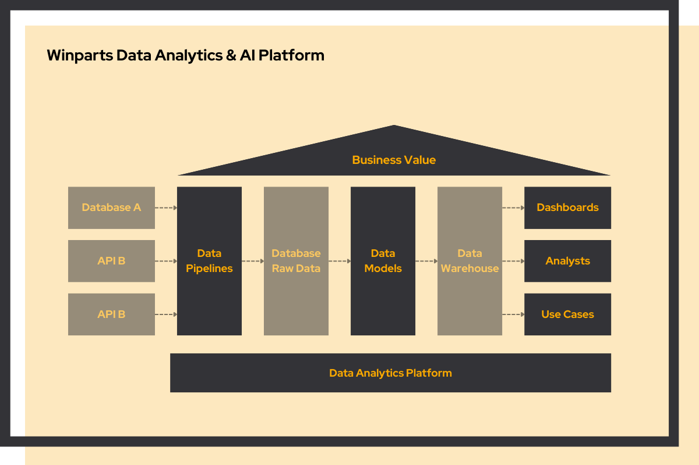
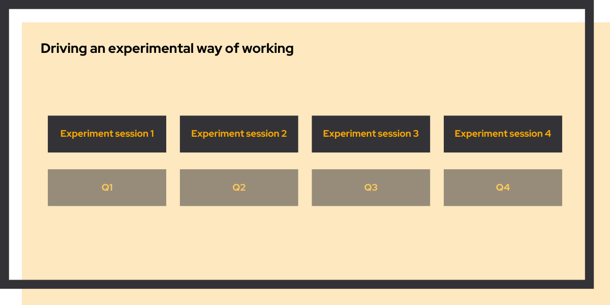

## The ambition

Winparts had been acquired by Alliance Automotive Group, part of Genuine Parts Company. The Dutch e-commerce platform was scaling to Europe. To do that, it needed a data foundation: proper infrastructure, automated pipelines, and the ability to answer business questions from data instead of gut feel. The ambition was clear. The path to it was blocked.

## The challenge

The technical work was straightforward. The organizational work was not.

**Build from zero, inside a corporate acquisition.** The entire cloud infrastructure needed to align with GPC's standards: cloud organization, networking, security, access management, governance. All of it had to be created before a single data pipeline could run.

**GCP-only with no externally hosted software.** Standard enterprise tools were off the table. Fivetran for data ingestion and Cloud Composer for orchestration were both ruled out. The platform had to be built differently.

**Blocked by approvals.** Corporate infrastructure couldn't be provisioned until sign-offs came through. The team needed to deliver business value, but the usual starting point wasn't available yet.

## Where we started

> Think big, start small.

We didn't wait. Instead of stalling on approvals, we ran two tracks in parallel: setting up the cloud infrastructure on one side, and building the data platform with dummy data on the other. By the time the real infrastructure was ready, the pipelines and models were already tested and proven.

**Cloud platform track**
- **Cloud organization**: GPC-compliant infrastructure: networking, security, access controls, governance

**Data platform track**
- **Data pipelines**: [DLT](/blog/why-dlt-beats-fivetran) on Cloud Run, in place of Fivetran

- **Data models**: [DBT](/blog/dbt-transform-data-into-insights) for reusable analytical models and analyst self-service

- **Orchestration**: Cloud Scheduler, in place of Cloud Composer

## Make it work, make it better, make it scale

When the cloud infrastructure was approved and ready, the data platform was already waiting. We connected the first real data sources, onboarded the first data engineer and analyst, and completed the returns use case: a full pipeline from raw data to business insight that optimized Winparts' returns process.

That first complete use case mattered more than it might seem. It proved the entire system worked end-to-end, built organizational confidence, and gave the team something real to show stakeholders.

From there, the pace accelerated. New use cases were onboarded in a fraction of the time. Analysts started answering questions that hadn't even been part of the original scope. The data warehouse grew into a strategic asset, use case by use case.

Winparts' team now runs the platform themselves.

## From data platform to AI platform

The foundation also turned out to be the easiest way to add AI. Rather than bolting on a separate AI stack, we extended the platform with **AI jobs**: lightweight, containerized processes that read from the warehouse, run an LLM task, and write the results back. The first AI job analyzes returns to spot patterns and improve product data, reusing the same infrastructure, the same governance, and the same team.

We shared the full story, including how we think about scaling AI jobs to new use cases, on stage at Data Expo. [Read the talk →](/talks)

## Driving an experimental way of working

*Winparts had good ideas but no way to know which ones worked. We helped them find out.*

Winparts wanted every team to make better decisions, faster. They had plenty of ideas for improving the business. What they lacked was a systematic way to know which ones actually worked. The ambition: build a culture where evidence, not instinct, drives what gets built.

### The challenge

The problem wasn't motivation. It was method.

**Changes were made without measuring impact.** Teams would implement improvements based on gut feeling, with no baseline and no way to know if anything moved. Good ideas and bad ideas looked the same afterward.

**No one knew how to design a proper experiment.** Turning a hunch into a testable hypothesis, with the right controls and success metrics, is a skill. It wasn't one the teams had yet.

**Learning wasn't accumulating.** Without a shared framework, the same assumptions kept getting made. Mistakes weren't recognized as mistakes because the feedback loop didn't close.

### Where we started

> Think big, start small.

We didn't run a training program. We coached teams through one real experiment on a real business challenge. The learning happened by doing, not by sitting in a workshop.

- **Opportunity finding**: Identified where a small, well-scoped test could reveal a meaningful business insight

- **Experiment design**: Turned vague ideas into testable hypotheses with clear success criteria

- **Guided execution**: Supported implementation to ensure results would be valid and interpretable

- **Results analysis**: Interpreted outcomes together and identified what to do next

Each quarter, teams ran a real experiment while building the skill to run the next one without us.

### Make it work, make it better, make it scale

The first experiment gave the team something they hadn't had before: a result they could trust. Not a gut feeling, but a measured outcome with a clear next step.

Each quarter we refined the approach. The hypotheses got sharper. The test designs got cleaner. Teams stopped asking "what should we test?" and started generating their own backlog of ideas worth validating.

By the end of the engagement, teams were designing and running experiments independently. They had adopted experimentation tooling to track results and started embedding the methodology into their regular workflow. We stopped being needed. That was the point.
