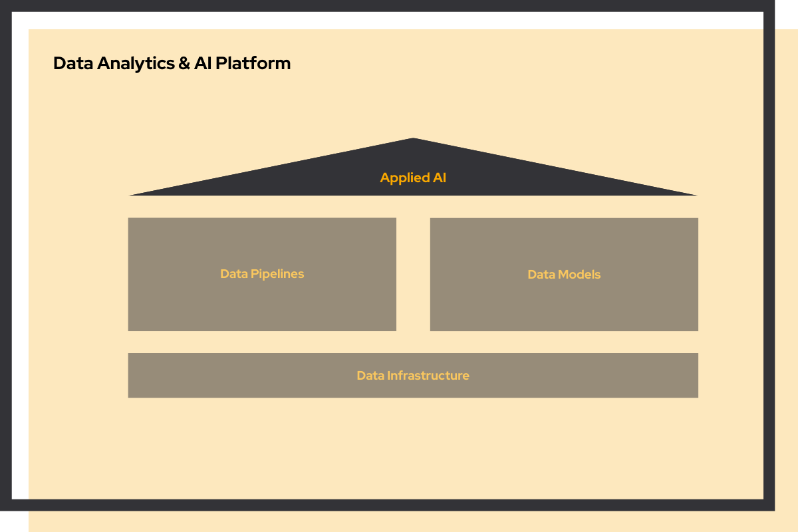

Your house is built (infrastructure), groceries arrive automatically (pipelines), and your kitchen is organized with proven recipes (models). Now you're ready for the smart home system: AI that learns your patterns, anticipates needs, and makes intelligent decisions automatically.

But here's the reality: you can't install a smart thermostat before you have electricity. You can't have an intelligent refrigerator without a kitchen. AI needs the foundation first.

We always advise: build your data foundation first, then layer AI on top. When you're ready, we'll help you deploy AI that delivers real business value, not just impressive demos. Whether it's predictive modeling or generative AI, we turn concepts into production systems and help you execute your first use case.

## Prerequisites: foundation first

Applied AI requires the full data platform stack:

-   **[Data Infrastructure →](/services/data-platform#data-infrastructure)** - Compute and storage for model training
-   **[Data Pipelines →](/services/data-platform#data-pipelines)** - Fresh data feeding your AI models
-   **[Data Models →](/services/data-platform#data-models)** - Clean, structured data for accurate predictions

**Don't have your foundation yet?** We recommend starting with infrastructure and working your way up. [Let's talk about your journey →](/contact)

## When is this service relevant?

You should consider Applied AI when:

-   You have a data platform but haven't deployed AI models
-   There's a clear business use case for AI/ML
-   Manual processes could be automated with AI
-   You want to improve products with intelligent features
-   Your team has the data but lacks AI expertise
-   You need to move from experimentation to production

## What are typical deliverables of the project?

### AI solution design

-   Use case definition and validation
-   Model architecture design
-   Data requirements and feature engineering
-   Success metrics and KPIs

### Implementation

-   Production-ready ML models or GenAI applications
-   API endpoints or user interfaces
-   Model training and deployment pipelines
-   Monitoring and alerting dashboards
-   A/B testing framework

### Knowledge transfer

-   Model documentation and decision logs
-   Code repository with CI/CD
-   Team training on model maintenance
-   Retraining procedures

## AI capabilities

We build various types of AI solutions:

### Predictive analytics

-   Forecasting (sales, demand, churn)
-   Classification (fraud detection, quality control)
-   Recommendation engines
-   Risk scoring models

### Generative AI

-   Custom ChatGPT-like applications
-   Document analysis and summarization
-   Content generation
-   Conversational AI assistants

### Computer vision

-   Image classification and detection
-   Quality inspection
-   OCR and document processing

### Natural language processing

-   Text classification and sentiment analysis
-   Named entity recognition
-   Language translation
-   Search and retrieval
