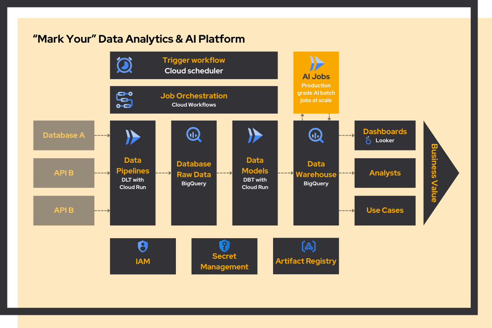
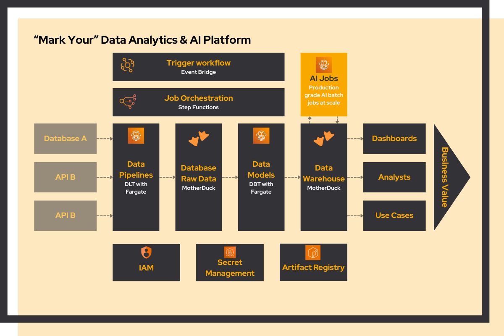
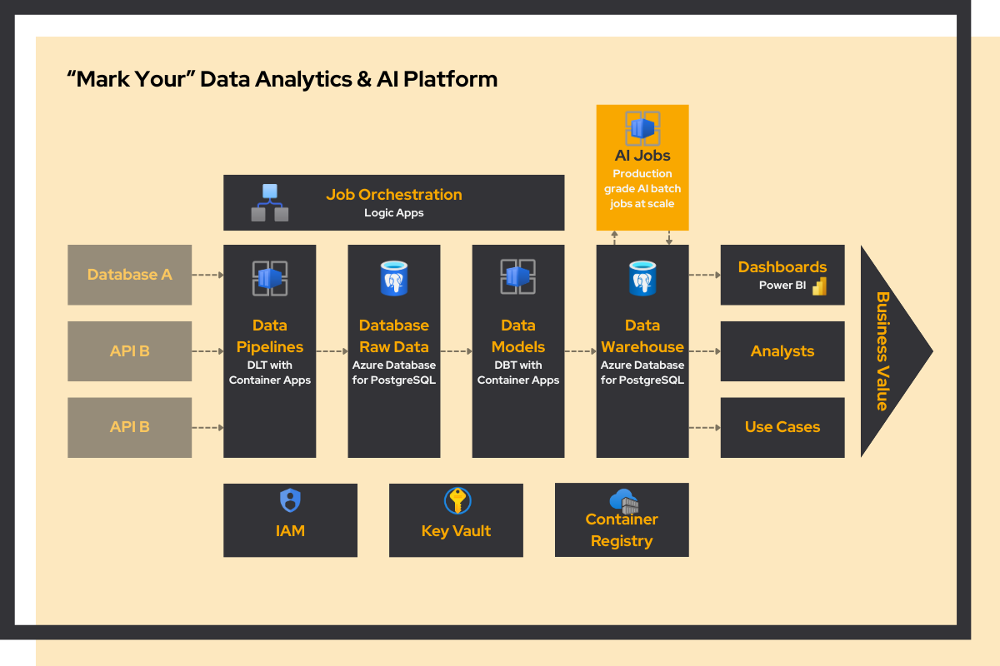
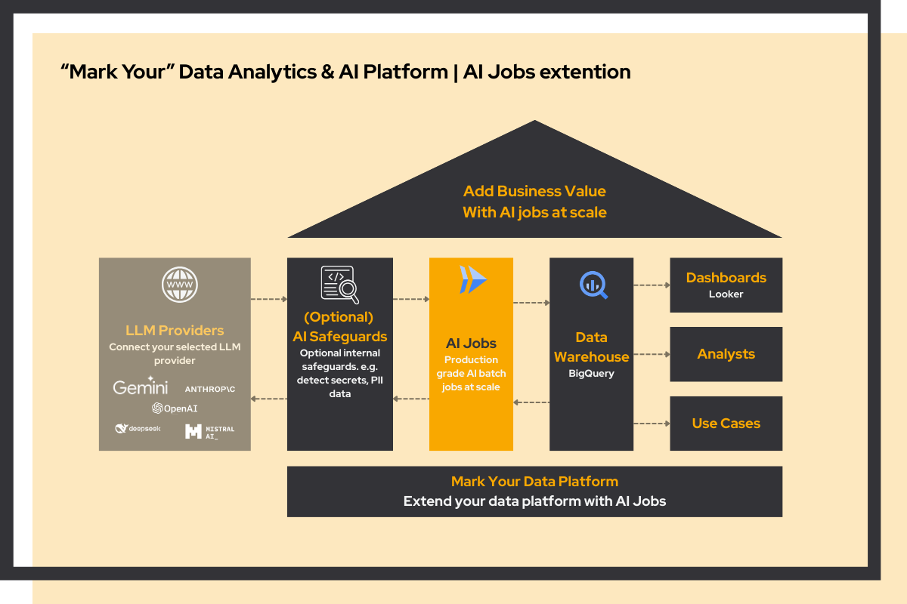
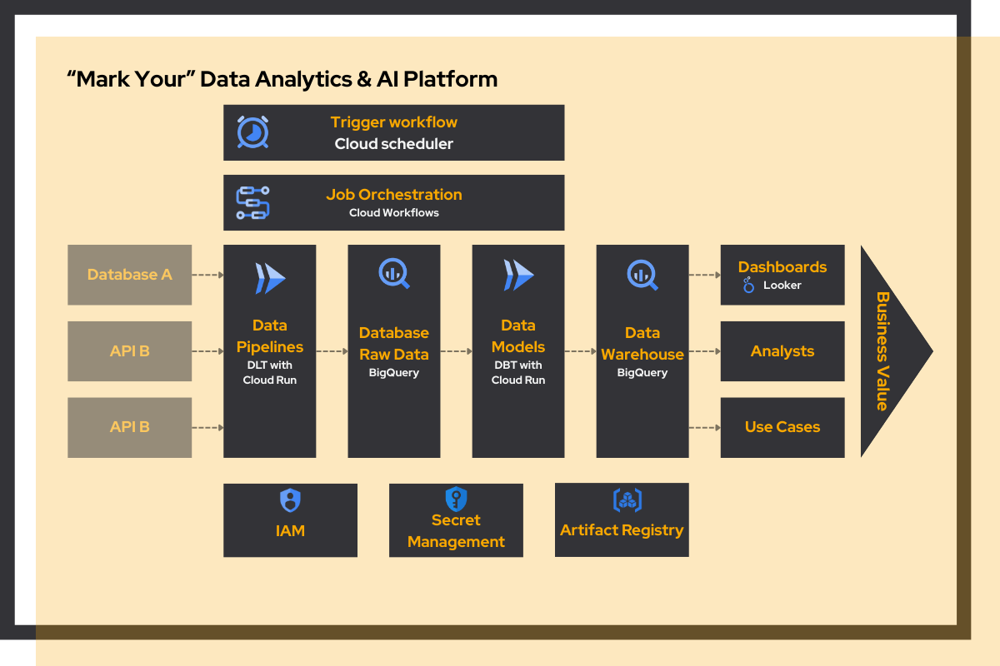
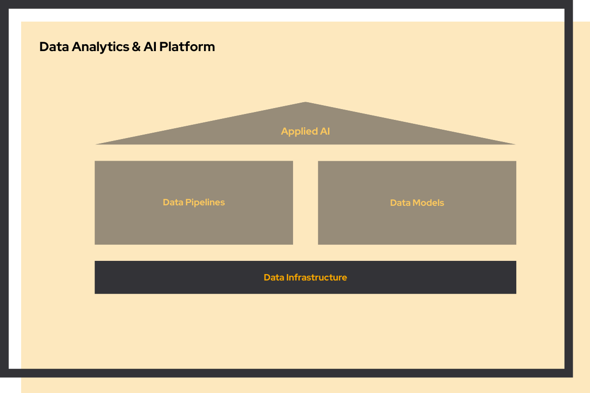
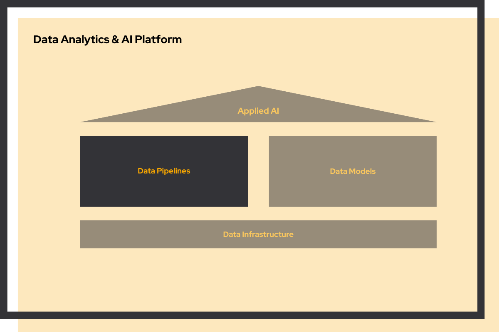
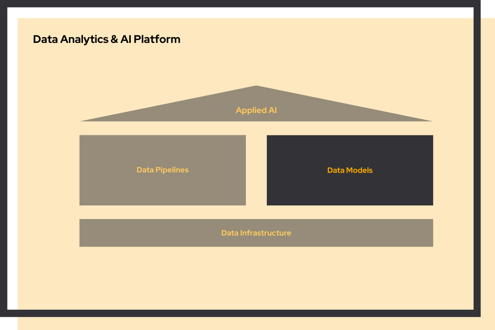

Your organization is growing. You've accumulated data across different systems and you want to become more data-driven. The natural instinct? Hire a data engineer. But at €100K per year, is that really the best investment?

**We don't think so.** Data engineers lay the foundation, but they don't directly add business value. It's your data analysts who turn data into insights and drive decisions. Why not invest in them instead?

Without a solid foundation, your analysts spend most of their time collecting and cleaning data rather than using it. **Mark Your Data & AI Platform** handles that layer, so they can focus on the work that actually matters.

**Already have a data engineer?** See how you can still [save €30K+ per year without replacing your team](#already-have-a-data-engineer).

**Not sure what you need yet?** Start with [fractional data & AI leadership](/services/quickscan#fractional-data--ai-leadership) to figure out your direction first.

## Save up to €100K per year

A traditional data setup with a data engineer costs around €215K per year. With our Mark Your Data & AI Platform, you skip the data engineer and the expensive tools, saving up to €100K annually.

### Traditional approach: €215K/year

**€100,000\*/year** - Senior Data Engineer

**€35,000\*/year** - Modern Data Stack

**€80,000\*/year** - Data Analyst

~€215K per year

\* indicative prices

### Mark Your Data & AI Platform

**€0** - No data engineer needed

**€35,000\*** - Mark Your Data & AI Platform

**€80,000\*/year** - Data Analyst

~€115K per year

**Save up to €100K+ annually.**

\* indicative prices

**Bottom line:** Invest in data analysts who drive business value, not in expensive infrastructure that just moves data around.

## Built on open-source, runs on your cloud

We use battle-tested open-source tools. No vendor lock-in, no per-row pricing, no black boxes. And it runs on whatever cloud you're already on: AWS, Azure, or GCP.

The overview below is aimed at engineers, CTOs, and technical evaluators. Feel free to share this page with your technical team.

GCP

The architecture uses a small set of managed GCP services, each doing one job well. Together they form a fully automated pipeline from source systems to dashboards, with no manual steps in between.

The stack is not fixed. You can swap in different reporting tools or replace the data warehouse entirely. BigQuery can be replaced with MotherDuck for even lower storage costs, for example. Note that MotherDuck currently runs on AWS only, so connecting it to a GCP-based pipeline may incur cross-cloud egress fees. Read [why we are enthusiastic about MotherDuck](/blog/motherduck-the-future-of-cost-efficient-analytics).

### Data flow

- **Cloud Scheduler** - Triggers Cloud Workflows on a fixed schedule. Daily, hourly, or any interval you need.
- **Cloud Workflows** - Orchestrates the pipeline. Triggers the DLT job, waits for it to complete, then triggers the DBT job.
- **DLT (Data Load Tool)** - Ingests raw data from your sources and writes it to BigQuery. Open-source alternative to Fivetran with ~5,000 GitHub stars. See our [DLT vs Fivetran comparison](/blog/why-dlt-beats-fivetran).
- **DBT (Data Build Tool)** - Reads the raw BigQuery data and transforms it into curated, combined datasets ready for analysis and reporting. Industry standard with ~10,000 GitHub stars. Read our guide: [Transforming Data into Insights with DBT](/blog/dbt-transform-data-into-insights).
- **BigQuery** - Serverless data warehouse that stores both the raw ingested data and the curated DBT output. Pay per query, no infrastructure to manage.
- **Looker Studio** - Dashboards built on the curated BigQuery datasets. Free, browser-based, no setup required.

### Platform foundation

- **Docker Containers** - Packages each pipeline as a portable, reproducible unit. Runs identically in development and production.
- **Artifact Registry** - Stores the container images used by Cloud Run Jobs.
- **Cloud Run Jobs** - Runs each containerized pipeline. Scales to zero when not in use.
- **Secret Manager** - Keeps API keys, passwords, and credentials out of your code.
- **IAM** - Defines roles with the right level of access. Data analysts get access to analyses datasets, reporting users get read-only access to reporting datasets.
- **Git version control** - Every pipeline is code. Tracked, reviewed, and reversible.

AWS

The architecture uses a small set of managed AWS services, each doing one job well. Together they form a fully automated pipeline from source systems to dashboards, with no manual steps in between.

The stack is not fixed. You can swap in different reporting tools or scale up the database. If your data grows to petabyte scale, MotherDuck can be replaced with Amazon Redshift. Read [why we default to MotherDuck on AWS](/blog/motherduck-the-future-of-cost-efficient-analytics).

### Data flow

- **Amazon EventBridge Scheduler** - Triggers Step Functions on a fixed schedule. Daily, hourly, or any interval you need.
- **AWS Step Functions** - Orchestrates the pipeline. Triggers the DLT job, waits for it to complete, then triggers the DBT job.
- **DLT (Data Load Tool)** - Ingests raw data from your sources and writes it to MotherDuck. Open-source alternative to Fivetran with ~5,000 GitHub stars. See our [DLT vs Fivetran comparison](/blog/why-dlt-beats-fivetran).
- **DBT (Data Build Tool)** - Reads the raw MotherDuck data and transforms it into curated, combined datasets ready for analysis and reporting. Industry standard with ~10,000 GitHub stars. Read our guide: [Transforming Data into Insights with DBT](/blog/dbt-transform-data-into-insights).
- **MotherDuck** - Serverless analytical database built on DuckDB, running natively on AWS. Stores both the raw ingested data and the curated DBT output. Fast, cost-effective, and no infrastructure to manage.
- **Amazon QuickSight** - Dashboards built on the curated MotherDuck datasets. Cloud-native BI with pay-per-session pricing, no server to manage.

### Platform foundation

- **Docker Containers** - Packages each pipeline as a portable, reproducible unit. Runs identically in development and production.
- **Amazon ECR** - Stores the container images used by AWS Fargate.
- **AWS Fargate** - Runs each containerized pipeline. Scales to zero when not in use, no cluster management needed.
- **AWS Secrets Manager** - Keeps API keys, passwords, and credentials out of your code.
- **AWS IAM** - Defines roles with the right level of access. Data analysts get access to development datasets, reporting users get read-only access to curated datasets.
- **Git version control** - Every pipeline is code. Tracked, reviewed, and reversible.

Azure

The architecture uses a small set of managed Azure services, each doing one job well. Together they form a fully automated pipeline from source systems to dashboards, with no manual steps in between.

The stack is not fixed. You can swap in different reporting tools or replace the database entirely. PostgreSQL can be replaced with MotherDuck for even lower storage costs and in-process analytics. Note that MotherDuck currently runs on AWS only, so connecting it to an Azure-based pipeline may incur cross-cloud egress fees. Read [why we are enthusiastic about MotherDuck](/blog/motherduck-the-future-of-cost-efficient-analytics).

### Data flow

- **Azure Logic Apps** - Schedules and orchestrates the pipeline. Triggers the DLT job on a fixed schedule, waits for it to complete, then triggers the DBT job.
- **DLT (Data Load Tool)** - Ingests raw data from your sources and writes it to PostgreSQL. Open-source alternative to Fivetran with ~5,000 GitHub stars. See our [DLT vs Fivetran comparison](/blog/why-dlt-beats-fivetran).
- **DBT (Data Build Tool)** - Reads the raw PostgreSQL data and transforms it into curated, combined datasets ready for analysis and reporting. Industry standard with ~10,000 GitHub stars. Read our guide: [Transforming Data into Insights with DBT](/blog/dbt-transform-data-into-insights).
- **Azure Database for PostgreSQL** - Open-source managed SQL database that stores both the raw ingested data and the curated DBT output. Cost-effective, fast, and natively queryable by DuckDB and MotherDuck.
- **Microsoft Power BI** - Dashboards built on the curated PostgreSQL datasets. Widely adopted, deeply integrated with the Azure ecosystem, and familiar to most analysts.

### Platform foundation

- **Docker Containers** - Packages each pipeline as a portable, reproducible unit. Runs identically in development and production.
- **Azure Container Registry** - Stores the container images used by Azure Container Apps.
- **Azure Container Apps** - Runs each containerized pipeline. Scales to zero when not in use, fully managed by Azure.
- **Azure Key Vault** - Keeps API keys, passwords, and credentials out of your code.
- **Azure Entra ID** - Defines roles with the right level of access. Data analysts get access to development datasets, reporting users get read-only access to curated datasets.
- **Git version control / Azure DevOps** - Every pipeline is code. Tracked, reviewed, and reversible.

## Extend with AI jobs

Your data platform is the input for AI. AI jobs run alongside your pipelines and data models, process data through an LLM, and write results back to the same warehouse. Set up the framework once, then add use cases one at a time.

[How AI jobs work](#ai-jobs)

## What this means for your business

### One source of truth

Every metric is defined once, tested, and reused across all reports. No more conflicting numbers between teams, no more debating which dashboard is right before you can make a decision.

### No vendor lock-in

Built on open-source tools. No per-seat licensing, no per-row pricing, no dependency on a vendor's roadmap. You own the setup and can extend it as you grow.

### Ready for AI when you are

Your data platform is the input for AI. AI jobs run alongside your existing pipelines and data models, writing their output back to the same platform. When you want to add an AI use case, you extend what's already there. No rebuild, no separate tooling.

[How AI jobs work](#ai-jobs)

### Yours to keep

No black boxes. Everything is transparent, version controlled, and in your hands. Your team can maintain and extend it independently. We set it up, you own it.

## Already have a data engineer?

You've already invested in a data engineer. Smart move. You have someone who understands your data landscape and can build pipelines. But are you getting the most value from your platform investment?

Many organizations spend **€35K+ per year** on "modern data stack" tools that your data engineer could replace with open-source alternatives. We help you make that transition, same capabilities, fraction of the cost.

Don't have a data engineer yet? See how you can [save €100K per year](#save-up-to-100k-per-year).

### Where your €35K per year goes

The "modern data stack" has become synonymous with expensive SaaS tools. Here's what you're likely paying today:

#### Typical enterprise stack

**€1,500/month** - Fivetran (data pipelines)

**€350/month** - Cloud Composer (Airflow orchestration)

**€1,000/month** - Data warehouse (Redshift/Snowflake/BigQuery)

~€35K per year

And that's before you add visualization tools, data catalogs, or quality monitoring.

#### Mark Your Data & AI Platform

**Free** - DLT for data pipelines (~5K GitHub stars)

**Free** - Cloud Scheduler (replaces Airflow)

**~€50/month** - MotherDuck (DuckDB in the cloud)

**~€50/month** - Cloud Run (serverless compute)

~€1,200 per year

**Save €30K+ annually.**

### Why make the switch?

#### Your engineer becomes more valuable

Instead of configuring SaaS tools, your data engineer can focus on building custom solutions that directly address your business needs. Code beats configuration.

#### No vendor lock-in

Open-source tools mean you own your code. Switch cloud providers, modify pipelines, or extend functionality without asking permission or paying extra.

#### AI-assisted maintenance

Because everything is code, tools like Claude and GitHub Copilot can help maintain and extend your platform. Try that with a SaaS configuration UI.

#### Scale to zero

With serverless compute (Cloud Run), you only pay when pipelines run. No more paying €350/month for an Airflow cluster that sits idle 90% of the time.

### Our lightweight architecture

We use battle-tested open-source tools wrapped in a scalable, cost-efficient infrastructure.

#### Key components

-   **DLT (Data Load Tool)** - Open-source data ingestion. Popular alternative to Fivetran with ~5,000 GitHub stars. Learn more in our [DLT vs Fivetran comparison](/blog/why-dlt-beats-fivetran).
-   **DBT (Data Build Tool)** - Industry standard for data transformation with ~10,000 GitHub stars. Read our guide: [Transforming Data into Insights with DBT](/blog/dbt-transform-data-into-insights).
-   **MotherDuck** - DuckDB in the cloud. Fraction of the cost of Snowflake or Redshift with excellent performance for analytical workloads.
-   **Cloud Run Jobs** - Serverless compute that scales to zero when not in use.
-   **Cloud Scheduler** - Simple, reliable scheduling without the overhead of managed Airflow.

### How we help you migrate

We work alongside your data engineer to transition from expensive tools to our lightweight stack.

Week 1-2

#### Assessment

We audit your current stack, identify migration priorities, and create a detailed transition plan with your team.

Week 3-6

#### Migration

We help your engineer rebuild pipelines using DLT and DBT, set up the new infrastructure, and run both systems in parallel.

Week 7-8

#### Cutover

Once validated, we switch over to the new platform and decommission the old tools. Your engineer is fully trained and autonomous.

## Platform services in detail

### Data infrastructure

Building a data platform without solid infrastructure is like constructing a house without a foundation. You can't install smart appliances before you have electricity. You can't run pipelines before you have walls and plumbing.

We build you the foundation (cloud infrastructure, security, and scalability) so everything else you build on top is stable, secure, and ready to grow. Whether you're on GCP, AWS, or Azure, we create a simple-to-use setup that's cost-effective and easy to work with.

#### What are typical deliverables of the project?

##### Infrastructure design

-   Architecture diagrams and technical specifications
-   Technology stack recommendations (cloud platform, databases, orchestration)
-   Security and governance framework
-   Cost estimates and scaling plan

##### Implementation

-   Deployed cloud infrastructure (AWS, Azure, or GCP)
-   Infrastructure as Code (Terraform)
-   CI/CD pipelines for automated deployments
-   Security controls and access management
-   Monitoring and alerting

##### Documentation & knowledge transfer

-   Technical documentation and runbooks
-   Architecture decision records
-   Team training sessions
-   Handover to your team

### Data pipelines

Your data infrastructure is built and the foundation is solid. Now you need to bring data in. Think of pipelines as your supply chain: they automatically deliver fresh groceries (data) from various suppliers (your systems) to your kitchen (data platform) every day.

Without pipelines, your team manually carries data back and forth. With pipelines, everything flows automatically, fresh, reliable, and on schedule. Their only job is to connect to data sources (databases, APIs) and copy the data to your central platform, ensuring your warehouse is always up to date.

#### What are typical deliverables of the project?

##### Pipeline design

-   Data flow diagrams and architecture
-   Source system integration strategy
-   Data quality rules and validation logic
-   Error handling and retry strategies

##### Implementation

-   Production-ready data pipelines
-   Automated data ingestion from all sources
-   Monitoring dashboards and alerting

##### Documentation & support

-   Pipeline documentation
-   Data lineage tracking
-   Team training
-   Ongoing support and maintenance plan

### Data models

You have a house (infrastructure) and groceries delivered daily (pipelines). But raw ingredients scattered across your counter aren't useful yet. You need recipes: clear instructions that turn random ingredients into consistent, delicious meals.

Data models are your recipes. They transform raw data into organized, ready-to-use products that anyone can pick up and trust. No more confusion about which version of "revenue" to use. No more analysts spending hours figuring out how to calculate basic metrics. Just standardized data products that save time and amplify your team's effectiveness.

#### When is this service relevant?

You should consider data modeling when:

-   It takes days to weeks to go from data question to answer
-   Analysts spend too much time understanding raw data
-   The same metric means different things to different teams
-   Query performance is unacceptably slow
-   You're implementing a new BI tool or data warehouse
-   Data governance and lineage are concerns
-   You need to democratize data access

#### What are typical deliverables of the project?

##### Data model design

-   Dimensional models (star schema)
-   Entity relationship diagrams
-   Metric definitions and business rules
-   Data dictionary and glossary

##### Implementation

-   dbt models or equivalent transformations
-   Materialized views and aggregate tables
-   Performance-optimized queries
-   Data catalog with documentation

##### Governance & documentation

-   Data lineage tracking
-   Business glossary
-   Data quality rules
-   Access controls and permissions

### AI jobs

Your data platform collects, cleans, and structures your data. AI jobs take that one step further: they read from your data platform, run a task using an LLM, and write the result back to the same platform. No separate tooling, no new architecture. It's a natural extension of what you already have.

Set up the framework once. Then add use cases one at a time.

#### How it works

An AI job is a lightweight container that runs alongside your existing pipelines and data models. It connects to an LLM provider, processes your data, and writes its output back to your data warehouse. Right where your analysts and dashboards already look.

#### Any LLM provider, your choice

The container connects to whichever LLM fits the task:

##### External providers

Connect to Claude, Gemini, ChatGPT, or any other hosted LLM. Pick the right model for each job based on cost, speed, and capability.

##### Internal models

Run an internally hosted model for sensitive data. An additional security layer sits in front of it, checking that no credentials or PII leave your environment before the request goes through.

The LLM clients, safeguards, and execution pattern are configured once. After that, adding a new use case means adding a new job, not rebuilding the framework.

#### What you can do with AI jobs

##### Annotation

Label data at scale. Classify support tickets, tag products, score sentiment across thousands of records automatically.

##### Summarization

Turn long-form content into structured output. Summarize customer feedback, contracts, or reports into fields your analysts can actually use.

##### Translation

Translate content across languages without leaving your data platform. Useful for international product catalogues, reviews, or communications.

##### Generation

Generate content from structured data. Product descriptions, email drafts, report narratives, all written at scale from the data you already have.

#### One use case at a time

You don't need to solve everything upfront. The strength of this setup is that it grows with you:

1.  **Set up the framework once:** container infrastructure, LLM clients, safeguards, execution pattern
2.  **Add your first job:** pick the use case with the clearest business value
3.  **Measure the output:** results land in your data platform alongside everything else
4.  **Add the next job:** reuse the same framework

Each job is independent. A new use case doesn't require touching the ones already running.

## Seen in practice

We don't just design platforms. We build and run them. The [Winparts Data & AI Platform](/cases/winparts) is one example of this approach in production.
