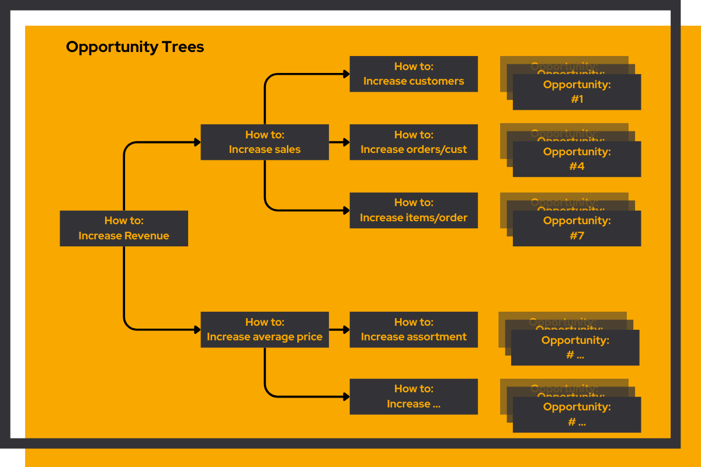
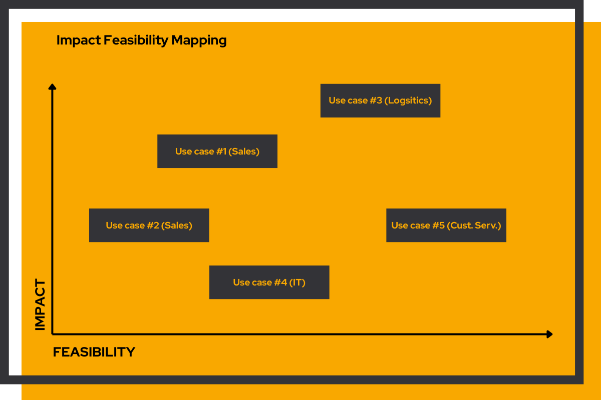
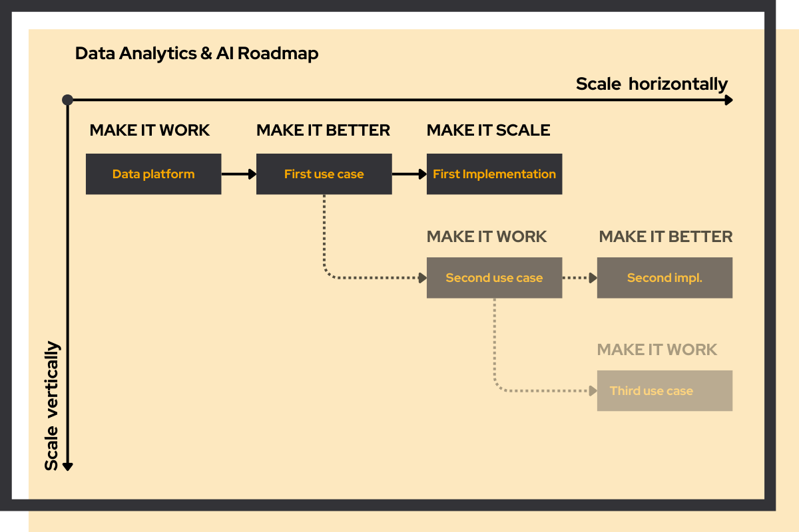

Data-driven answers that don't agree with each other are a signal, not a fluke. **Our Data & AI quickscan checks your team, tools, data pipelines, and data models** to reveal exactly where the painpoints are, so you know what to fix and in what order.

### Our approach

We follow a proven three-step methodology. **Opportunity finding:** map how value is created in your organization and discover where small changes can make a big impact. **Use case prioritization:** balance impact with feasibility to identify initiatives that deliver maximum value with minimal risk. **Roadmap creation:** transform your strategy into a clear action plan.

### Opportunity finding

**Discover where a small change can make a big impact.** We start by understanding your business and how value is created. Then we identify which areas only require a small change to have a big impact on business objectives.

### Use case prioritization

**Focus on what matters most.** We identify initiatives where a small change can have a major impact, balancing impact with feasibility. These use cases become the starting point of your roadmap.

### Data & AI roadmap

**Strategy becomes action.** We create a clear plan for the coming year. Starting with the selected use cases, the roadmap shows how to add value and grow your data & AI capability over time.

## Think Big, Start Small

Two days to find your biggest data & AI opportunity, and the first logical step to get there.

Every consultant tells you to "do something with AI". In practice, most companies get stuck: thinking too big without starting, or starting too small without thinking. We solve this by combining business and strategic thinking with deep technical know-how. Together we find what actually matters and make it executable.

Berend and Mark did exactly this dozens of times in a fun and energizing way. We covered a broad range of projects in domains like branding, marketing, advertising, logistics, finance and customer care, you name it. With great success, which is why we have now combined all that experience in this workshop where we help you take the first step in data & AI.

We take care of everything: a unique and focused venue away from your office, good coffee, a proper healthy lunch. Show up with your team. We handle the rest.

<figure><figcaption><strong>Mark Schep</strong> Data & AI Engineer</figcaption></figure>
<figure><figcaption><strong>Berend Dumas</strong> Data Scientist & AI Engineer</figcaption></figure>

Combined, Berend and Mark have successfully delivered 20+ high-impact projects with proven value.
[Berend's testimonials](https://www.dumasdataconsultancy.nl/#testimonials) · [Example projects](/cases)

## Two day program

**Day 1. Think big: finding the biggest value.** You walk away with a clear view of where the biggest improvements lie, what they're worth, and how data and AI can get you there.

**Day 2. Start small: the first logical step to get there.** You walk away with a concrete next step to act on the first use case, and a one-page plan to execute.

**€6.000. Two days. Real direction.** [Book the quickscan](/contact)

## How we can help

Choose the engagement that fits your situation.

### Data & AI quickscan

Getting inconsistent or unreliable answers from your data? In two days, we check your team, tools, data pipelines, and data models, and reveal exactly where the painpoints are so you can solve them.

[Book the quickscan](#think-big-start-small)

### 30-minute call

Have a specific question or need an outside perspective? Schedule a call with one of our senior consultants. No strings attached.

[Schedule a call](/contact)

### Data & AI offsite

Bring your team together for a focused workshop. We lead the session and guide you through opportunity finding, prioritization, and roadmap creation.

[Learn more](/contact)

### Strategy engagement

Need more hands-on support? We work alongside your team to develop your data & AI strategy and set up the organization for execution.

[Learn more](/contact)

### Fractional leadership

Need senior direction on an ongoing basis, not just a fixed engagement? We step in as your fractional data & AI leader, one or more days a week, covering strategy, data & AI engineering, and team building, until you're ready to lead independently.

[Learn more](/services/quickscan#fractional-data--ai-leadership)

## Fractional Data & AI leadership

We take on the data leadership role in your company, one or more days per week. Senior direction without the full-time commitment.

Your company is growing and data is becoming more important. You know you need someone to lead this. But finding the right person is hard when you don't yet know exactly what problems you're solving, what tools you need, or what kind of team to build around it.

A wrong hire at leadership level sets you back by a year. **A fractional engagement moves you forward.** We step in as your data & AI leader, covering both strategy and hands-on data & AI engineering, get the first use cases running, and help you figure out exactly who to hire next.

### Why start fractional?

#### A senior data leader is expensive

A full-time senior hire comes with a full-time price tag. One or more days a week gives you the same level of expertise at a fraction of the cost, matched to what you actually need at this stage.

#### You don't yet know who to hire

Without clarity on your data challenges, the right tooling, and the team you want to build, hiring is a guess. After a fractional engagement, you'll know exactly what profile to look for. That's a much better position to recruit from.

#### You need an allrounder, not a specialist

When you're getting started, you don't need someone who goes deep in one area. You need someone who can cover strategy, data & AI engineering, and people all at once, and grow your capabilities one use case at a time.

### How it works

Three phases that take you from strategy to independence.

#### Phase 1: Strategic foundation

**Translate company goals into a data roadmap**

-   Identify high-value use cases
-   Build a data & AI roadmap aligned with business goals
-   Define success metrics and KPIs
-   Map what tools, data, and roles you need

#### Phase 2: Platform design & engineering

**Define and build your technical foundation**

-   Design your data architecture and tooling
-   Select the right tools for your situation
-   Build the pipelines and models you need
-   Establish data governance frameworks

For most growing organizations, the [Mark Your Data & AI Platform](/services/data-platform) is a strong fit. It's what we use ourselves and have deployed for clients like [Winparts](/cases/winparts).

#### Phase 3: Team building & execution

**Deliver results and build internal capability**

-   Lead execution of initial use cases
-   Define what roles to hire and in what order
-   Coach and develop your team's capabilities
-   Establish best practices and ways of working

#### Our commitment

We stay on board until your team has delivered one or more use cases AND you know exactly what you need from a permanent hire. At that point, you're not guessing anymore. You're making an informed decision.
